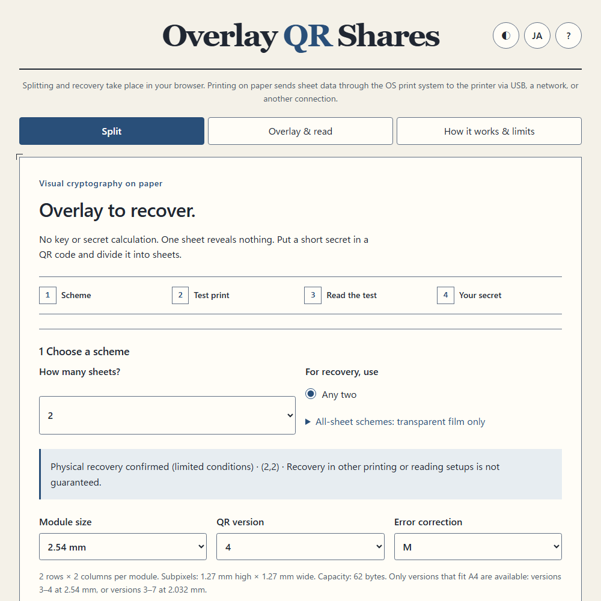
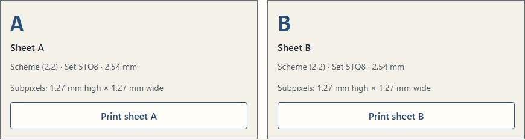
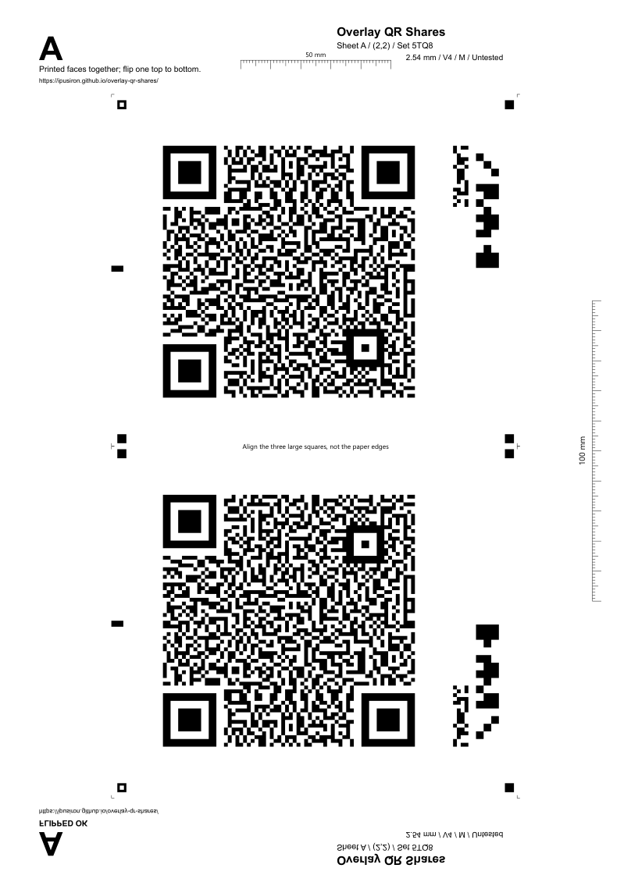
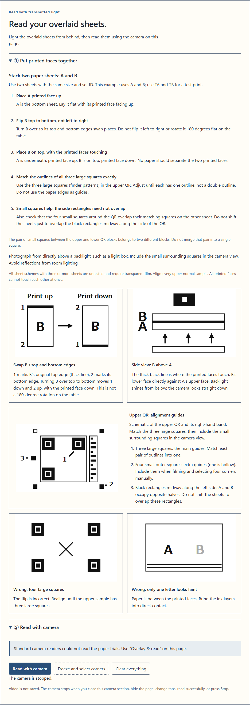
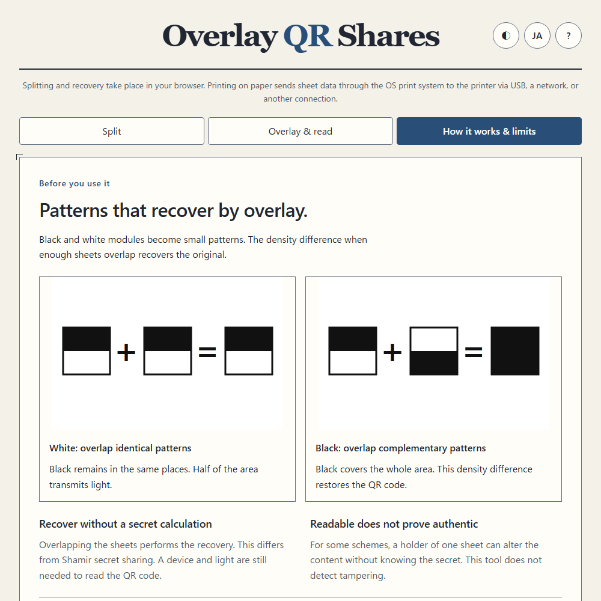

English · [日本語](README.md)

# Overlay QR Shares - Recover a secret QR by overlaying printed shares


[](https://ipusiron.github.io/overlay-qr-shares/)

**Day125 - 200 Security Tools with Generative AI**

Overlay QR Shares is a tool that splits a QR code containing a secret string into 2–5 visual cryptography sheets, then reads the required overlay with a camera.
Choose “any two” or “all” to try keeping short recovery codes, safe combinations, and similar information in separate places.
In the author's physical trials on 2026-10-24, an iPhone recovered overlays of two paper sheets using (2,2), version 4, M, and a light box at both 2.54mm and 2.032mm module sizes.
This confirmation applies only to the recorded conditions; before entering a real secret, complete a test print and recovery using the intended printer and material.

The name combines “overlay” for placing sheets on top of one another, “QR” for the code, and “shares” for the distributed pieces.
While Day124 reconstructs a secret through numerical computation, this tool recovers QR contrast through the optical OR of black areas on paper or film.
A device is still needed to classify that contrast and recover the string.

## 🌐 Demo

👉 **[Open Overlay QR Shares](https://ipusiron.github.io/overlay-qr-shares/)**

Download the complete repository and open `index.html` using `file://` to run it locally.
The app makes no external requests and has no runtime CDN or additional package requirements.
If the local browser cannot use the camera, follow the on-screen link to the GitHub Pages version.
For secrets, use a saved copy of the code on a trusted device, and check offline operation in advance.

## 📸 Screenshots

The five screenshots below use light mode and the test-vector string `TEST-OQS-1`.
The round buttons at the top right control the theme, language, and help.


> *Choose the number of shares and recovery condition, starting with a test print.*


> *Select sheets by symbol and set ID without displaying their patterns on screen.*


> *A demo A4 sheet with a normal sample above and its vertical reflection below.*


> *① Put printed faces together; ② Read with camera. Both sections start open and can be collapsed independently.*


> *Overlaying black and white patterns, and tradeoffs with numerical secret sharing.*

## ✨ Features

- Seven schemes with 2–5 sheets, recovered by “any two” or “all”
- QR versions 3–7, error correction M or Q, and two module sizes where they fit on A4
- Remaining UTF-8 byte count, notices for URL-like text and surrounding whitespace, and rejection of unpaired surrogates
- Randomness checks, basis checks, all required and one-fewer subsets, and a representative image reading check
- Separate print actions for sheets A–E, test sheets TA–TE, rulers, calibration, and machine-readable metadata
- Automatic camera reading and a manual four-point helper using one frozen frame
- Masked recovered values, explicit reveal and copy actions, and a clear-all action
- Japanese and English, light and dark themes, layouts from 320px, and keyboard operation

## 📖 Usage

### 1. Print and read a test

In “Split,” choose the sheet count and recovery condition.
Start with (2,2), QR version 4, error correction M, and 2.54mm modules.
The test string is generated randomly and does not use the secret input.
Versions 3 and 4 produce separate test sets for 2.032mm and 2.54mm; each sheet is printed on its own A4 page.
Versions 5–7 fit only at 2.032mm.
Do not mix sheets with different sizes or set IDs, even if both carry the symbol TA.

The two-sheet example uses A and B (TA and TB for a test print).

1. **Place A flat with its printed face up.**
2. **Turn B over top to bottom, not left to right, so its printed face points down.** Its top and bottom edges exchange places. This is not a 180-degree rotation flat on the table.
3. **Place B on top of A, with B's printed face directly touching A's printed face.**

Align the three large squares (finder patterns) of the upper QR until the corresponding outlines from both sheets coincide.
Use the surrounding small squares (one is hollow) as secondary references: match corresponding positions on the two sheets.
**The black rectangles halfway along the side of the QR do not need to overlap each other.** Do not shift the sheets just to make these rectangles overlap.
Include the upper QR and its surrounding small squares in the camera frame.
Also check that the reflected “FLIPPED OK” label is readable.
Do not align the paper edges.
A printer's positional offset doubles when one sheet is flipped; the author's preliminary trial produced a 3mm offset.

Pass enough light through the back of the stacked paper and capture it from the opposite side.
A light box makes it easier to keep the sheets flat; reduce room lighting if it causes excessive surface reflections.
If four large squares appear, check how the sheet was flipped; if only one sheet's text looks faded, check that the printed faces touch.
In the author's preliminary paper trial, a standard camera app could not read the overlaid pattern.
Reading with standard camera apps is not guaranteed.
Use the “Read overlay” tab, and verify that the test value is recovered before proceeding to production.
This is a user's confirmation and does not change the published scheme status to physically tested.
Separately from those preliminary observations, physical recovery with the released OQS v1 format has been confirmed for the (2,2), version 4, M, 2.54mm and 2.032mm conditions documented below.

The “all” schemes with 3–5 sheets are experiments using transparent film.
It is impossible for all printed faces of three or more sheets to be in mutual contact.
Stack the upper normal samples in the same orientation and separately assess spacing and bleeding caused by material thickness.
This is not a procedure for stacking 3–5 sheets of ordinary paper.

### 2. Create production sheets

Confirm that a test was read using the same scheme and module size, then enter the secret.
The initial version 4/M settings allow 62 bytes; this is not the same as a character count for non-ASCII text.
Input is never silently trimmed, normalized, or shortened.
URL-like text and surrounding whitespace produce notices, but creation remains available after the user checks them.

After creation, the result says that this is a functional check, not a security audit.
Check the symbol and set ID and print each sheet separately using actions such as “Print sheet A.”
Changes that alter the patterns invalidate the old set, and stale results from work already in progress are discarded.
Changing the language or theme does not regenerate the set.

### 3. Read the overlay

The tab has two sections: “① Put printed faces together” and “② Read with camera.”
Both start open; select either heading to collapse or expand that section.
Once the sheets are ready, you can collapse section ① and use section ② to read them.
Closing section ② stops the camera. Reopening it does not restart the camera automatically.

“Read with camera” requests the rear camera.
Processing proceeds through registration-mark candidates, finder patterns, the metadata band, illumination, and module contrast.
The “Adequate,” “Borderline,” and “Insufficient” diagnostics describe image conditions; they do not prove that a secret or sheet is authentic.
Messages about alignment or illumination also describe possible causes.

If automatic reading fails, freeze one frame and select registration-mark centers in image order: top left, top right, bottom right, bottom left.
A magnifier and snapping to nearby marks are available.
Use arrow keys to move, hold Shift for finer movement, and press Enter or Space to select a point.
“Select corners again” resets the selected points; “Cancel and erase image” clears the frozen image.

When a value is read, the camera stops and the value remains masked.
Use “Reveal” to inspect it, and “Copy text” only when needed.
Copied values may enter the operating system's clipboard, clipboard history, or synchronization services.
The camera also stops on a stop action, a tab change, page hiding, or leaving the page.

### 4. Check and clear after printing

After collecting the required sheets and checking the rulers and test recovery, follow the post-print checklist and store the shares separately.
Collect and shred failed prints, then use “Clear everything” to remove input, sheets, and recovered values.
Arrays are overwritten with zeros and frozen images are cleared, but JavaScript strings and internal browser or operating-system copies cannot be guaranteed to be erased.

### Print settings

- Print from a PC on A4, single-sided, in black only
- Use 100% scale (“Default” in Chrome, “100%” in Firefox), without automatic fit-to-page
- Disable borderless printing, headers and footers, and toner saving
- Measure the 100mm vertical ruler and 50mm horizontal ruler on the actual print
- Use paper or film compatible with the printer
- Record the printer, material, module size, and illumination that passed the test

The artwork uses pure-black SVG and does not require printing CSS backgrounds.
Each sheet contains a normal sample and a vertical reflection on the same A4 page.
Both module sizes cannot fit on one A4 page with the specified layout, so test sets also use separate pages for each size.

### Choosing a light source

The required arrangement captures the black/white contrast in light that has passed through both sheets.
A light box is convenient because it illuminates from behind while supporting the paper flat, but the device itself is not required.
The general arrangement of illumination behind an object and a camera receiving the transmitted image is described in [KEYENCE's lighting selection guide](https://www.keyence.com/products/vision/resources/vision-resources/basics-of-lighting-selection.jsp).

| Light source | Conditions to prepare | Physical confirmation with this tool |
|---|---|---|
| Light box | Illuminate the entire reading area from behind and keep the sheets flat | Recovery confirmed for (2,2), version 4, M, 2.54mm and 2.032mm as documented below |
| Sunlight | Place a bright window or similar source behind the paper, with the camera on the opposite side. Hold the paper flat and fixed, with uniform transmitted light across the entire reading area | Unconfirmed; a possible substitute in principle |
| An iPad or another white screen | Display full-screen white at sufficient brightness, covering the entire reading area. Keep the paper flat and capture it using a separate iPhone or another camera | Unconfirmed; a possible substitute in principle |

Ceiling lighting that illuminates paper on a desk only from the front produces substantial surface reflection and little light passing through both sheets.
Scattering and absorption by the paper, along with uneven lighting, further reduce the black/white contrast.
Under these lighting conditions, dark-region camera noise and motion blur from longer exposures can be expected to make reading harder.
Indoor use can still be tried with sufficient backlighting; the presence of room lighting alone does not make reading impossible.
Only a light box was confirmed in the supplied physical photographs; sunlight and white-screen recovery have not been measured.

## 🧾 Schemes and physical test status

`(k,n)` means that n sheets are created and k are needed for recovery.
The white and black figures below are black-area fractions under ideal stacking of the required sheets, not measured camera brightness.

| Scheme | Required sheets | Subpixel layout | White black-area fraction | Black black-area fraction | Role | Physical status |
|---|---:|---|---:|---|---|---|
| (2,2) | 2 | 2×2 | 0.5 | 1 | Primary | Physical recovery confirmed (version 4/M, 2.54mm or 2.032mm, conditions below only) |
| (2,3) | 2 | 2×2 | 0.5 | 0.75 | Experimental | Untested |
| (2,4) | 2 | 2×2 | 0.5 | 0.75–1 | Experimental | Untested |
| (2,5) | 2 | 2×2 | 0.5 | 0.75–1 | Experimental | Untested |
| (3,3) | 3 | 2×2 | 0.75 | 1 | Transparent-film experiment | Untested |
| (4,4) | 4 | 2×4 | 0.875 | 1 | Transparent-film experiment | Untested |
| (5,5) | 5 | 4×4 | 0.9375 | 1 | Transparent-film experiment | Untested |

### Conditions with confirmed physical recovery

The author's supplied photographs and reading screens confirm recovery of the respective test values under the following two conditions.
The author explicitly confirmed the 2.54mm module size; the printed label in the additional photograph identifies the 2.032mm size.

| Item | 2.54mm example | 2.032mm example |
|---|---|---|
| Date | 2026-10-24 | 2026-10-24 |
| Sheets and QR settings | TA and TB, (2,2), version 4, error correction M | TA and TB, (2,2), version 4, error correction M |
| Reading device | iPhone | iPhone |
| Light source | Light box | The same light box |
| Recovered test value | `TEST-B3967BF33EFC` | `TEST-24DE75D71F98` |
| On-screen diagnosis | ○ Adequate | × Insufficient |
| Decoding result | Decoded successfully | Decoded successfully |

For both conditions, automatic versus manual reading, device model, printer, paper product and thickness, whether room lights were off, and illuminance remain unconfirmed.
The diagnosis classifies an estimated contrast margin using provisional thresholds; it is separate from the decoding result.
In the 2.032mm example, the string was decoded despite the “Insufficient” diagnosis, so that diagnosis must not be read as a decoding failure.


> *The author's physical trial: paper sheets TA and TB on a light box, using (2,2), version 4, M, and 2.54mm modules.*


> *The supplied iPhone screen shows recovered TEST-B3967BF33EFC and an “Adequate” diagnosis in Japanese.*


> *The additional trial stacks TA and TB using (2,2), version 4, M, and 2.032mm modules on the same light box.*


> *The screen shows successful decoding of TEST-24DE75D71F98; its “Insufficient” diagnosis is separate from decoding success.*

The number of supplied success screens is not used to infer a success count or rate.
These records are examples of recovery under those two conditions; they do not establish success with different QR settings, printers or materials, sunlight, or a white screen.
The other six schemes remain untested.

### Planned physical trials

| Target | Material and conditions | Result |
|---|---|---|
| (2,2) | Additional conditions at both sizes, different QR settings, and substitute sunlight or white-screen illumination | Additional trials planned; only the 2.54mm and 2.032mm examples above are confirmed |
| (2,3) | Change the required pair and capture under the same conditions | Planned |
| (2,4) | Change the required pair and capture under the same conditions | Planned |
| (2,5) | Change the required pair and capture under the same conditions | Planned |
| (3,3) | Stack three sheets of compatible transparent film and capture | Planned |
| (4,4) | Stack four sheets of compatible transparent film and capture | Planned |
| (5,5) | Stack five sheets of compatible transparent film and capture | Planned |

The [author's physical trial procedure](PRINT_TRIAL.md) specifies page counts, observations to record, and captures to make.
Observations from preliminary prototypes, the physical trial above, and synthetic image results are kept separate.
Synthetic success alone does not add any physically tested conditions.

## 🔬 How overlay recovery works

Each QR module is replaced by several small black and white cells.
In (2,2), the tool uses the six 2×2 patterns that contain two black cells.
For a white module, both sheets receive the same pattern; for a black module, they receive complementary patterns.
Overlaying them makes white modules half black and black modules entirely black, allowing the QR to be recovered from the contrast.

A single sheet has the same pattern distribution whether it represents a white or black module.
More generally, the tests check that the multisets of basis columns for white and black agree for subsets smaller than the required number.
This combinatorial property establishes secrecy in the ideal model; failure to read a few random examples does not establish it.

### Public and shared modules

Finder patterns, separators, timing patterns, alignment patterns, the dark module, and version information are independent of the secret and are printed openly.
Format information is shared.
Its mask number is chosen by the encoder from the data, so publishing it could leak up to three secret-dependent bits.

The scheme, QR version, error correction, module size, and set ID in the machine-readable band are public.
The set ID helps prevent mixing sets and is not an authentication value.
This scheme does not conceal QR margins or public metadata.

### Randomness and creation checks

Production randomness comes from `crypto.getRandomValues`, with rejection sampling for integers and Fisher–Yates shuffling.
Creation stops if random acquisition fails or the initial random sample is stuck at a single value.
These checks do not prove the security of the randomness source.

The app checks each sheet's structure and black-cell count, recovery from every required subset, and failure to recover from every subset with one fewer sheet.
It also creates normal and mirrored synthetic images of one representative subset and checks that the reader recovers the original string.
These are functional checks.
They do not establish physical print quality, the security of the entire implementation, or the absence of deliberate alteration.

## ⚖️ Tradeoffs with Day124

| Aspect | Day125 Overlay QR Shares | Day124 Scatter Seeds |
|---|---|---|
| Recovery | Stack sheets and classify contrast with a camera | Collect numerical shares and reconstruct with Shamir sharing |
| Requirements | Required sheets, one device, transmitted light, a flat surface, and alignment | Required shares and a device or restoration script to read them |
| Sheet counts | (2,2)–(2,5) and (3,3)–(5,5) | Select threshold k and total n |
| Capacity | 62 bytes at version 4/M; up to 122 bytes in the supported range | A numerical format for strings and seeds; see that tool's limits |
| Errors and tampering | Band CRC and QR error correction; no authentication of deliberate changes | CRC, a short fingerprint, and consistency of extra shares; no authentication tag |
| Plaintext during recovery | The overlaid pattern, camera image, and reading device | The device performing reconstruction |
| Main constraints | Printing, material, illumination, misalignment, and local distortion | Trust in share input and numerical implementation |

Both approaches assume that the creator can see the secret, that holders of enough shares can cooperate, and that devices and printing routes must be trusted.
Choose after considering the differences in computation and physical handling.

## ⚠️ Limits and tampering

- In (2,2) and (n,n), a holder of one sheet can make some changes without knowing the original secret. Public differences can produce changes that pass QR error correction; tests reproduce this
- There is no creator authentication or detection of deliberate alteration when an untrusted sheet is supplied. CRCs and set IDs can also be rebuilt or copied
- Viewing a portion where enough sheets overlap exposes the corresponding pattern. Treat photos and scans of overlays as recoverable secrets
- Copied sheets cannot be revoked. When changing a value, create a complete fresh set with new randomness and change the secret at the original service too
- Moisture, film stretching, bending, and local distortion cannot be corrected by a projective transformation alone
- Printing and material change the outcome. More sheets reduce transmitted light; the theoretical area difference for (5,5) is only 1/16
- The browser, operating system, extensions, randomness source, and printer must be trusted. Memory clearing does not guarantee complete erasure
- Keep another recovery method and perform periodic reading checks; do not rely on this as the only backup

The app does not display shared or reconstructed QR patterns on screen.
Standard camera apps may retain scanning history, synchronize to the cloud, or automatically open URLs.
Print previews, physical prints, screen sharing, and screenshots require separate handling.
This app's camera does not automatically open recovered strings.

## 🖨️ Printing route and network interception

An app that makes no network requests does not ensure that data between the operating system and printer is encrypted.
Wi-Fi or LAN printing may expose the patterns; the author's environment used HTTP for WSD printing.
For real secrets, connect the printer directly by USB and avoid unnecessary network printing.

One print job in this implementation contains only the selected sheet.
However, sending each sheet over the same route allows retained jobs to be collected into a complete set.
Check the spooler, printer job history and storage, shared-printer administration, and print-service retention policies.
Saving a PDF leaves an electronic copy of a share that may be included in cloud synchronization or backups.
Clearing the app after printing does not remove these copies.

## 🔒 Storage guidance

Keep the required number of sheets from being stored together by separating locations or custodians.
Make sure each custodian can identify the set ID, sheet symbol, required count, and recovery procedure; keep explanatory notes about the secret separately when appropriate.
Inspect paper condition and print fading periodically, and check actual overlay recovery.

The app persists only language and theme preferences.
Secrets, sheets, and recovered values are not stored in localStorage, sessionStorage, IndexedDB, URLs, or history.
It uses no network APIs, inline scripts, style attributes, or WASM, and its CSP forbids connections.
These measures do not guarantee protection against a compromised device or data collection by extensions.

## 🎯 Use cases

Ways of using this tool in particular

- Family members or co-custodians keep one (2,2) sheet each for a safe combination and practice recovering it together. Loss of one sheet requires a separate recovery route
- Split a recovery code across three locations using (2,3) and plan recovery from any two. Perform the functional checks for all three pairs and separate physical reading trials
- Two people keep a Wi-Fi password and practice recovery with one smartphone and transmitted light, without a dedicated cryptographic device. Version 4/M holds up to 62 bytes
- In a lesson or exhibition, observe the six (2,2) patterns and the black-area fractions of 0.5 for white and 1 for black. Use demo strings for demonstrations
- A puzzle designer places five (2,5) cards around a game, allowing any two to reveal a clue. Theft prevention and participant authentication require separate design

At work, the tool can support practice of shift handovers and collection of printed materials.
For hobbies and research, use the same demo string while varying material, module size, illumination, and sheet count, and record reading conditions.
For art and crafts, the sheets provide an example of contrast changing through physical overlap.
The author does not encourage misuse.

## 📐 OQS v1 format

### A4 layout and capacity

A4 is 210×297mm, and no component is placed within 8mm of an edge.
For QR version V and module size m, the QR body is `N = 17 + 4V`, and its width including four-module quiet zones is `Q = N + 8`.
The sample is `(Q + 7)m` wide and `Qm` high, with one spacing column, a 2-column × 8-row calibration band, another spacing column, and a 3-column × 16-row metadata band on the right.
The normal sample starts at `x = (210 − (Q + 7)m) / 2`, `y = 148.5 − 1 − 5 − Qm`.
The lower half uses the reflection `y → 297 − y`; 3mm registration marks sit 2mm away from the four corners, with only the top-left mark hollow.

| Module size | (2,n) subpixel edge | Versions that fit |
|---|---|---|
| 2.032mm | 1.016mm | 3–7 |
| 2.54mm | 1.27mm | 3–4 |

| QR version | M capacity (bytes) | Q capacity (bytes) | Public modules |
|---|---:|---:|---:|
| 3 | 42 | 32 | 244 |
| 4 | 62 | 46 | 252 |
| 5 | 84 | 60 | 260 |
| 6 | 106 | 74 | 268 |
| 7 | 122 | 86 | 427 |

For version 4, M, and 2.54mm, `Q = 41`, the sample measures 121.92×104.14mm, the normal sample starts at (44.04,38.36)mm, and the reflected sample's bounding top-left is (44.04,154.5)mm.
The calibration band starts at (150.72,48.52)mm and the metadata band at (158.34,48.52)mm.
In UTF-8, 20 copies of the three-byte Japanese character shown below occupy 60 bytes and fit, while 21 occupy 63 bytes and exceed capacity.

```text
秘
```

All coordinates, pattern hashes, random-byte consumption, and known sets are fixed in [test/vectors.json](test/vectors.json).

### Machine-readable metadata bits

The 48 bits are placed row-first in 3 columns and 16 rows.
Bit positions start at zero, and fields are stored most-significant bit first.

| Bits | Length | Contents |
|---|---:|---|
| 0–3 | 4 | Format version: 1 for OQS v1 |
| 4–7 | 4 | Scheme ID: 1–7 map to 2-2, 2-3, 2-4, 2-5, 3-3, 4-4, 5-5 |
| 8–11 | 4 | QR version minus 3 |
| 12 | 1 | Error correction: M = 0, Q = 1 |
| 13–15 | 3 | Size code: 2.032mm = 0, 2.54mm = 1 |
| 16–35 | 20 | Set ID: four 5-bit characters |
| 36–39 | 4 | Reserved: all zeros |
| 40–47 | 8 | CRC-8: polynomial 0x07, initial value 0, covering the five bytes of the first 40 bits |

The set ID alphabet is `ABCDEFGHJKLMNPQRSTUVWXYZ23456789`.
The CRC is processed most-significant bit first with no final XOR.
The reference (2,2), version 4, M, 2.54mm set with ID `M9VH` has this band:

```text
000100010001000101011111111001100111000000101000
```

## 🐍 Recovery without the browser tool

[read_photo.py](read_photo.py) uses only the Python standard library to turn a PNG photograph of an overlay into a QR image in PBM format.
It needs neither the original secret, the original QR, nor a JavaScript runtime.
Specify the centers of the four registration marks in image order: top left, top right, bottom right, bottom left.

```sh
python read_photo.py photo.png --corners "120,90 1480,110 1460,1280 100,1260" --output recovered.pbm
```

The coordinates are examples and must be replaced with those from the actual photograph.
Input is limited to 8-bit, non-interlaced PNG in grayscale, RGB, or either with alpha; alpha is composited onto white.
Palette images, 16-bit images, and tRNS are unsupported.
Save JPEG input as a supported PNG first.
Limits are 24 megapixels, 16,384px per side, and 64MiB per file.

The script tries eight rotations/reflections and seven version/size candidates, using the band CRC and public metadata to determine the layout.
Output has a four-module quiet zone on each side and an initial scale of 8; `--scale 1` through `--scale 32` are available.
If necessary, use `--threshold-offset` with `-0.2`, `-0.1`, `0`, `0.1`, or `0.2` to adjust classification relative to the calibrated contrast, trying a different output filename.
Existing output files are not overwritten.

Python does not decode the QR into a string, so recovery of the secret string remains unverified.
Exit code 0 means only that a PBM was produced; a separate QR reader is needed.
Exit code 1 indicates an input, band, calibration, or output error, and 2 indicates invalid command-line arguments.
The PBM stores the recovered secret as a QR image and must be handled like the secret itself.
Consider external readers' history, cloud synchronization, and automatic URL opening.

## 🧪 Synthetic image robustness

The table below is generated from [test/robustness.json](test/robustness.json) by `tableMarkdown()`.
Figures are successful images/trials, not physical success rates.

<!-- robustness:start -->
| Scheme | Baseline | Shift 0.25 / 0.75 mm | Blur 1 / 3 px | Ink 0.65 / 0.40 | Light slope 0.25 / 0.55 |
|---|---|---|---|---|---|
| (2,2) | 2/2 | 2/2; 2/2 | 2/2; 2/2 | 2/2; 2/2 | 2/2; 0/2 |
| (2,3) | 2/2 | 2/2; 2/2 | 2/2; 2/2 | 2/2; 2/2 | 2/2; 0/2 |
| (2,4) | 2/2 | 2/2; 2/2 | 2/2; 2/2 | 2/2; 2/2 | 2/2; 0/2 |
| (2,5) | 2/2 | 2/2; 2/2 | 2/2; 2/2 | 2/2; 2/2 | 2/2; 0/2 |
| (3,3) | 2/2 | 2/2; 2/2 | 2/2; 2/2 | 2/2; 2/2 | 2/2; 0/2 |
| (4,4) | 2/2 | 2/2; 0/2 | 2/2; 2/2 | 2/2; 2/2 | 2/2; 0/2 |
| (5,5) | 2/2 | 2/2; 0/2 | 2/2; 2/2 | 2/2; 0/2 | 2/2; 0/2 |
<!-- robustness:end -->

### Measurement conditions and scope

The string is `TEST-OQS-1`; QR settings are version 4, M, and 2.54mm; the fixed test seeds are 125001 and 125002.
The baseline uses 12px/mm, ink 0.85, blur 0, light floor 0.05, gain 0.8, and light slope 0.
Each sheet is rendered separately and transmissions are multiplied; only the cropped normal image, including registration marks, is given to the automatic reader.
The reader receives no correct geometry, metadata, or secret.

For each scheme, one representative subset comprising the first required sheets is tested at baseline and eight altered conditions, using both seeds.
Shift moves only the second sheet by 0.25mm or 0.75mm; the other axes change per-layer blur radius, ink, or image illumination slope one at a time.
Blur is measured in pixels, and light slope is a dimensionless synthetic-model parameter.
Of 63 conditions and 126 images, 106 recovered the original string.
Every scheme failed at light slope 0.55; (4,4) and (5,5) failed at 0.75mm shift; (5,5) failed at ink 0.40.
Results from just two seeds are not generalized to physical media or unmeasured combinations of conditions.

The JSON records SHA-256 hashes of eight files: randomness, visual cryptography, QR, layout, rendering, reading, test helpers, and the measurement script.
Ordinary tests check this record and the table; they do not silently repeat the expensive measurement.

### Sampling density for the creation image check

The representative image check uses a density of at least six pixels along the shorter subpixel edge.
The formula is `max(6, ceil(6 × max(r,c) / m))`px/mm, giving 12px/mm at 2.032mm and 10px/mm at 2.54mm for (5,5).
A one-pixel blur radius corresponds to the inverse of that density in millimeters.
This defines synthetic sampling for a functional check and does not imply improved physical robustness.

At (5,5), 2.032mm, and 8px/mm, the shorter edge is 4.064 pixels; a one-pixel blur radius and 3×3 center averaging mix neighboring subpixels and reading fails.
This remains a documented low-resolution failure condition.
The reader averages all r×c subpixels with equal weights rather than sampling only the module center.

## 🧪 Tests

### Automated tests

Use Node 22 or later.
No additional npm dependencies are required; GitHub Actions runs `npm test` on push and pull_request.

```sh
npm test
npm run robustness
```

`npm test` checks basis matrices, randomness, every fixed vector, all split/recovery subsets, secret-independent modifications, QR capacity and public modules, layout, rendering, image reading, CSP, translations, contrast, formatting, and the READMEs.
README numbers, JSON-generated robustness tables, bilingual headings, images, YAML, and the distribution file list are also checked.
`npm run robustness` is an explicit measurement using fixed seeds that updates the JSON.
The Python recovery test reads the PBM generated from synthetic PNGs with a QR decoder; if Python is unavailable, the test reports a skip.

| Test files | Checks |
|---|---|
| `basis.test.js`, `rng.test.js` | Basis distributions and theoretical values, randomness, and rejection sampling |
| `split.test.js` | Known answers, every required subset, and every one-fewer subset |
| `malleable.test.js`, `blind-malleable.test.js` | Sheet modifications, including changes without the secret |
| `qr.test.js`, `layout.test.js` | QR capacity, public modules, A4 geometry, and band CRC |
| `render.test.js` | SVG paths and independently rendered synthetic layers |
| `reader-sample.test.js`, `reader.test.js` | Sampling, detection, rotation, reflection, projection, and manual corners |
| `read-photo.test.js` | Python PNG input, PBM output, and malformed inputs |
| `static.test.js`, `i18n.test.js` | CSP, storage, vendor files, translations, and forbidden wording |
| `contrast.test.js`, `format.test.js` | Colors, line lengths, and file formatting |
| `readme.test.js` | Documentation numbers, languages, images, YAML, and distribution files |
| `robustness.js`, `robustness.json` | Explicit measurement and saved results |

### Browser checks

```sh
python test/interface.browser.py
python test/print.browser.py
python test/camera.browser.py
python test/screenshot.browser.py
```

Browser tests require Python Playwright and its browsers; PDF measurements use PyMuPDF.
Chromium, Firefox, and WebKit are checked at 320/390/1280px in both languages and themes, with reduced motion and keyboard navigation for tabs and help.
Chromium checks creation from `file://`, separate single-sheet PDFs, rulers, subpixel dimensions, and zero horizontal overflow.
Automated tests do not print physical sheets.

Camera tests build fake video from synthetic images at 1280×960 or higher, checking automatic recovery, masking, stopping, manual four-point input, cancellation, and array clearing.
Camera start and stop from `file://` are checked in Chromium and Firefox; Firefox's fake camera is not used to test reconstruction.
WebKit is checked for display behavior.
These tests do not replace trials with physical cameras, paper, or film.

## 🔗 Prior work and related tools

The foundations of visual cryptography are described in Naor and Shamir's [Visual Cryptography, author version](https://www.wisdom.weizmann.ac.il/~naor/PAPERS/vis.pdf).
Many studies of splitting and overlaying QR codes with visual cryptography have appeared since around 2011, including [Fang (2011)](https://doi.org/10.1109/IIHMSP.2011.10), Cao et al. (2016), and Liu, Yan, and Pan (2019).
[Cao et al.'s 2016 paper](https://www.atlantis-press.com/proceedings/aiie-16/25866401) also combines QR codes and visual cryptography.
This tool follows the same overlay-recovery approach and combines seven schemes, normal/reflected artwork, registration marks, calibration, diagnostics, test printing, and a bilingual UI without network requests.
It does not claim a new cryptographic scheme or a world-first mechanism.

- [Day124 Scatter Seeds](https://ipusiron.github.io/scatter-seeds/): a practical tool for splitting secrets into paper shares with Shamir sharing and reconstructing them numerically
- [Day070 VisualCryptography CipherLab](https://ipusiron.github.io/visual-cryptography-cipherlab/): a tool for learning visual cryptography patterns and overlays
- [Day102 QRCrashTest](https://ipusiron.github.io/qrcrashtest/): a tool for experimenting with QR reading and damage, and the source of the bundled QR libraries and licenses

## 📁 Directory structure

```text
overlay-qr-shares/                     # Complete tool distribution
├── .gitattributes                     # Text line-ending rules
├── .github/                           # GitHub configuration
│   └── workflows/                     # Automated checks
│       └── test.yml                   # Tests using Node 22
├── index.html                         # Three tabs and help
├── style.css                          # Screen and A4 print styles
├── app.js                             # UI, printing, camera, and clearing
├── messages.js                        # Japanese and English strings
├── rng.js                             # Cryptographic randomness and shuffling
├── vc-core.js                         # Bases, splitting, and overlaying
├── qr.js                              # QR encoding and public modules
├── layout-core.js                     # OQS v1 layout and metadata band
├── render-core.js                     # SVG paths and synthetic images
├── reader-core.js                     # Mark detection and image reading
├── read_photo.py                      # Standard-library PNG-to-PBM recovery
├── package.json                       # Node test commands
├── README.md                          # Japanese documentation
├── README.en.md                       # English documentation
├── PRINT_TRIAL.md                     # Author's physical trial procedure
├── LICENSE                            # Tool's MIT license
├── assets/                            # UI captures and supplied physical-trial images
│   ├── screenshot.png                 # Split tab
│   ├── sheets.png                     # Sheet cards
│   ├── print-sheet.png                # Single-sheet print preview
│   ├── overlay-read.png               # Stacking diagrams and reading
│   ├── limits.png                     # Principles and limits
│   ├── physical/                      # Physical-trial images shared by both READMEs
│   │   ├── tracebox-ta-tb.jpg         # TA and TB on a light box
│   │   ├── iphone-recovery.png        # iPhone recovery at 2.54mm
│   │   ├── tracebox-ta-tb-2_032.jpg   # TA and TB at 2.032mm
│   │   └── iphone-recovery-2_032.png  # iPhone recovery at 2.032mm
│   └── en/                            # English light-mode screenshots
│       ├── screenshot.png             # Split tab
│       ├── sheets.png                 # Sheet cards
│       ├── print-sheet.png            # Single-sheet print preview
│       ├── overlay-read.png           # Stacking diagrams and reading
│       └── limits.png                 # Principles and limits
├── vendor/                            # Locally loaded libraries
│   ├── qrcode.min.js                  # qrcode-generator 1.4.4
│   ├── jsQR.js                        # QR decoding
│   ├── LICENSE-qrcode-generator.txt   # qrcode-generator license
│   └── LICENSE-jsQR.txt               # jsQR license
└── test/                              # Automated checks and measurement data
    ├── basis.test.js                  # Basis matrices and theoretical values
    ├── rng.test.js                    # Randomness and rejection sampling
    ├── split.test.js                  # All subsets and known splits
    ├── malleable.test.js              # Sheet malleability
    ├── blind-malleable.test.js        # Modifications without the secret
    ├── qr.test.js                     # Capacity and public modules
    ├── layout.test.js                 # A4 layout and the 48-bit band
    ├── render.test.js                 # SVG and synthetic images
    ├── reader-sample.test.js          # Sampling with known geometry
    ├── reader.test.js                 # Automatic detection and manual corners
    ├── read-photo.test.js             # Python PNG and PBM handling
    ├── static.test.js                 # CSP, storage, and vendor files
    ├── i18n.test.js                   # Translations and forbidden wording
    ├── contrast.test.js               # Text contrast in both themes
    ├── format.test.js                 # Line lengths and formatting
    ├── readme.test.js                 # Bilingual docs, numbers, and distribution
    ├── helpers.js                     # Deterministic test randomness
    ├── vectors.json                   # Fixed known answers
    ├── robustness.js                  # Explicit synthetic measurement
    ├── robustness.json                # Results and eight source hashes
    ├── interface.browser.py           # Layout and keyboard checks
    ├── print.browser.py               # PDF page count and dimensions
    ├── camera.browser.py              # Fake video, stopping, and clearing
    └── screenshot.browser.py          # Bilingual demo screenshots
```

## 💻 Requirements

Use a current browser supporting JavaScript, SVG, Canvas, and `crypto.getRandomValues`.
Camera access requires `getUserMedia` and permission; availability from `file://` varies by browser and operating system.
A smartphone can be used for reading, but printing should be done from a PC.
Node 22 or later is used for development tests.
Standalone PNG recovery requires Python 3.8 or later; browser tests need a Python environment supported by the installed Playwright version. Neither is needed to run the normal page.

## 📄 License

This tool is released under the [MIT License](LICENSE).
The bundled qrcode-generator 1.4.4 and jsQR retain their respective [qrcode-generator license](vendor/LICENSE-qrcode-generator.txt) and [jsQR license](vendor/LICENSE-jsQR.txt).
Tests check the SHA-256 hashes of the four files copied from Day102.

## 🛠️ About this tool

This tool was developed as part of “200 Security Tools with Generative AI,” a project in which security book author IPUSIRON uses generative AI to build one security tool each day for 100 days.

👉 [Project details](https://akademeia.info/?page_id=44607)
