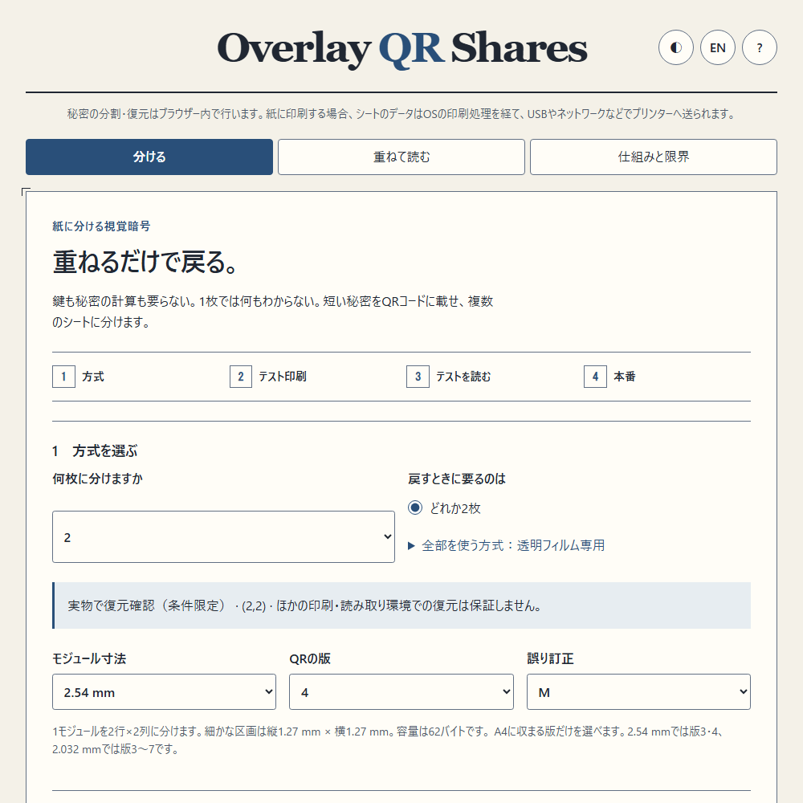
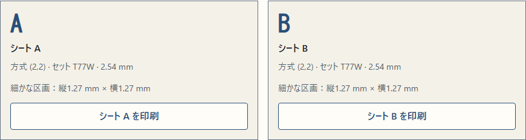
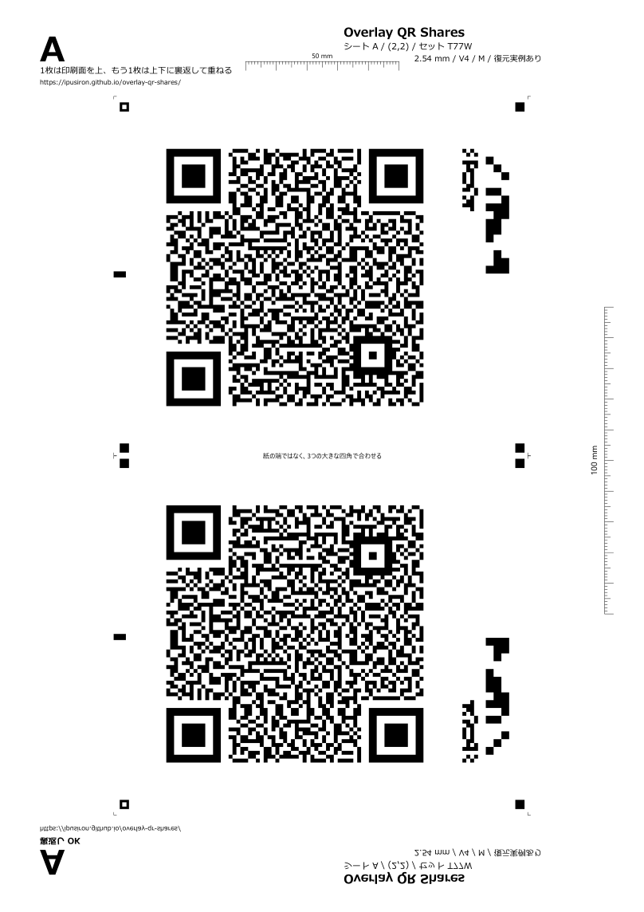
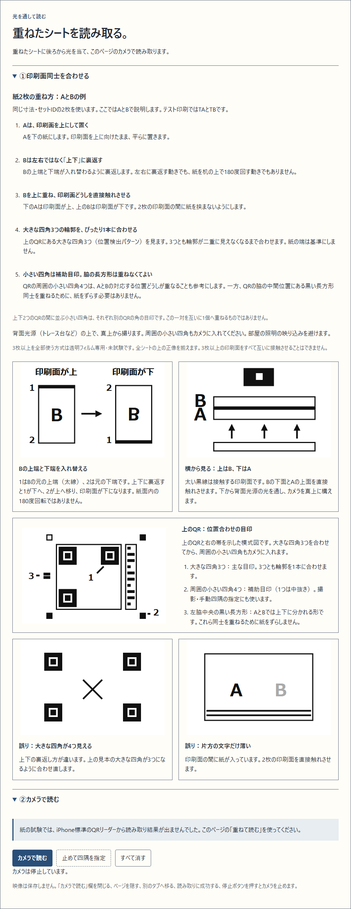
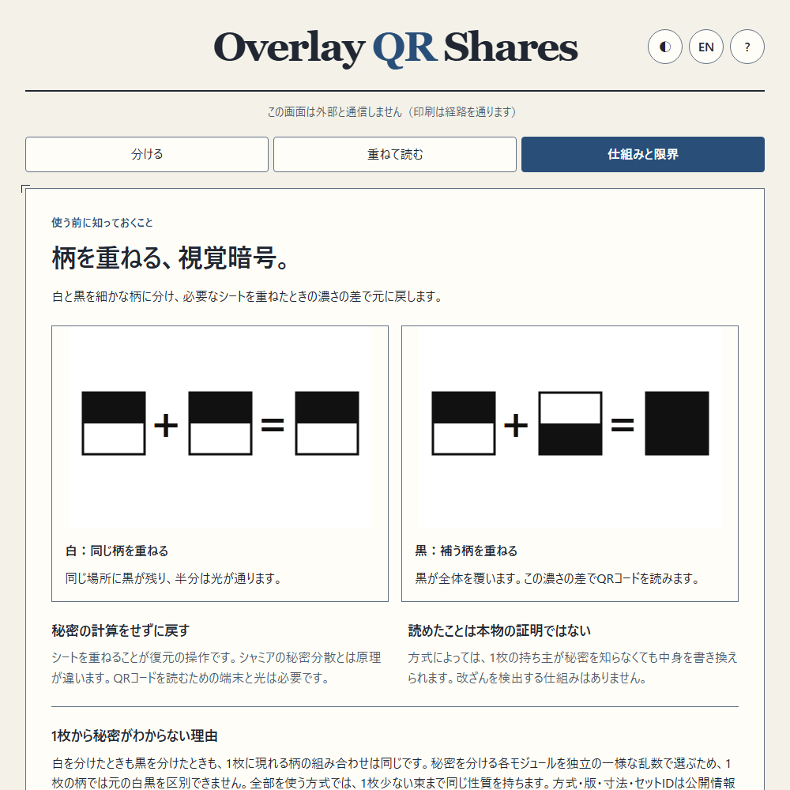
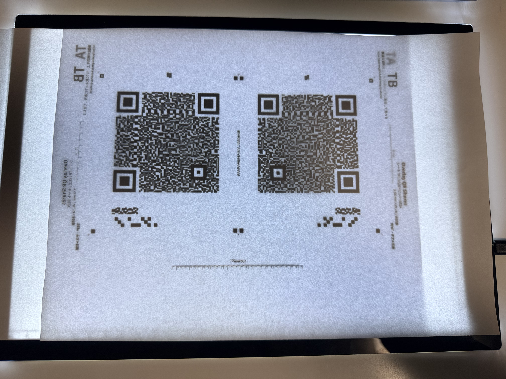
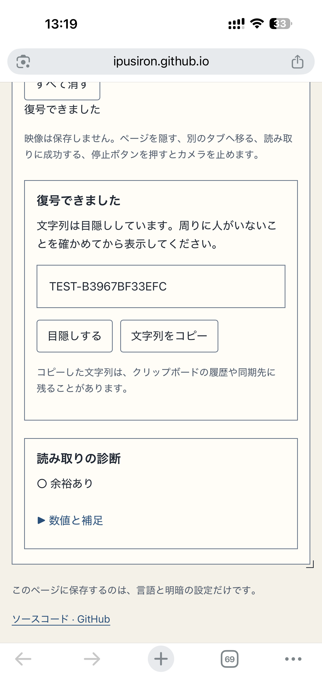
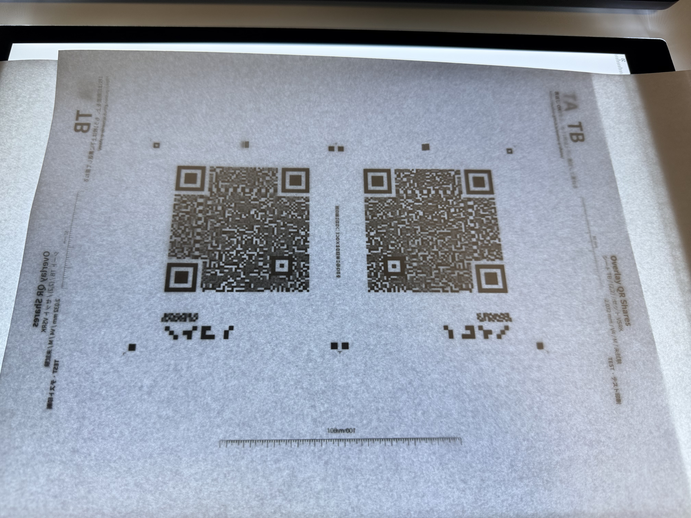
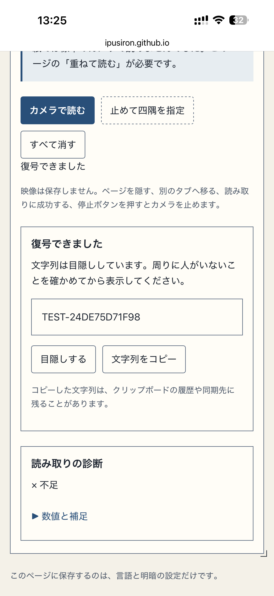

<!--
---
id: day125
slug: overlay-qr-shares
title: "Overlay QR Shares"
subtitle_ja: "紙を重ねて戻す秘密のQR"
subtitle_en: "Recover a secret QR by overlaying printed shares"
description_ja: "秘密のQRを視覚暗号で2〜5枚に分け、必要な枚数を重ねてカメラで読み取る、通信不要のツール。"
description_en: "Split a secret QR into 2–5 visual cryptography shares and read the required overlay with a camera, without network requests."
category_ja:
  - QRコード
  - プレッパー
category_en:
  - QR Code
  - Prepping / Survival
difficulty: 3
tags:
  - visual-cryptography
  - qr-code
  - secret-sharing
  - paper-backup
  - offline
repo_url: "https://github.com/ipusiron/overlay-qr-shares"
demo_url: "https://ipusiron.github.io/overlay-qr-shares/"
hub: true
---
-->

# Overlay QR Shares - 紙を重ねて戻す秘密のQR

[English](README.en.md) · 日本語


[](https://ipusiron.github.io/overlay-qr-shares/)

**Day125 - 生成AIで作るセキュリティツール200**

Overlay QR Sharesは、秘密の文字列を載せたQRコードを視覚暗号で2〜5枚のシートに分け、必要な枚数を重ねてカメラで復元するツールです。
「どれか2枚」または「全部」を選び、短い復旧コードや金庫の番号などを別々に保管する使い方を試せます。
2026-10-24の作者の実物試験で、(2,2)、版4、Mの紙2枚をトレース台で重ね、2.54mmと2.032mmの両寸法でiPhone上の本ツールによる復元を確認しています。
この確認は記録した条件に限られるため、本番の秘密を入れる前に、使うプリンターと素材でテスト印刷から読み取りまでを確認する必要があります。

名前は、重ねることを表す「overlay」、QRコードの「QR」、分け札を表す「shares」を組み合わせています。
秘密分散を数値計算で戻すDay124とは異なり、紙やフィルムの黒い部分を重ねる光学的なORでQRの濃淡を戻します。
その濃淡を判定して文字列に戻すための端末は必要です。

## 🌐 デモページ

👉 **[Overlay QR Sharesを開く](https://ipusiron.github.io/overlay-qr-shares/)**

リポジトリーを一式保存し、`index.html`を`file://`で開いても使えます。
アプリは外部へ通信せず、実行時のCDNや追加パッケージはありません。
カメラを使えないローカル環境では画面の案内からGitHub Pages版を開いてください。
秘密を扱う場合は、保存したコードと信頼できる端末を使い、オフラインでの動作も事前に確認してください。

## 📸 スクリーンショット

以下の5枚はライトモードで、例の文字列はテストベクターの`TEST-OQS-1`です。
右上の丸いボタンでテーマ、言語、ヘルプを切り替えます。


> *枚数と戻す条件を選び、テスト印刷から始める画面。*


> *図柄を画面に出さず、記号とセットIDでシートを選んで印刷。*


> *A4の上半分に正像、下半分に上下の鏡像を置いたデモ用の版下。*


> *①印刷面同士を合わせる、②カメラで読む。両方とも開いた状態から、必要に応じて個別に折りたためます。*


> *白黒の柄を重ねる原理と、計算による秘密分散との比較。*

## ✨ できること

- 2〜5枚のシートから「どれか2枚」または「全部」で戻す7方式
- 版3〜7、誤り訂正MまたはQ、A4に収まる2種類のモジュール寸法
- UTF-8の残りバイト数、URLらしい文字列と前後の空白への注意、孤立サロゲートの拒否
- 乱数の点検、基底行列の検査、必要枚数の全組と1枚少ない全組の確認、代表画像の読み取り
- 記号A〜Eを使う1枚ずつの印刷、テスト用のTA〜TE、物差し、較正の帯、機械読み取り帯
- カメラの自動読み取りと、止めた1フレームの4点を指定する手動補助
- 読み取った値の目隠し、明示操作での表示とコピー、全データを消す操作
- 日本語と英語、ライトとダーク、320pxからの画面、キーボード操作

## 📖 使い方

### 1. テスト印刷と読み取り

「分ける」で枚数と戻す条件を選びます。
最初は2枚に分けて2枚で戻す(2,2)、版4、誤り訂正M、2.54mmから試してください。
テスト用の文字列はランダムに作られ、秘密の入力欄は使いません。
版3と4では2.032mmと2.54mmのテストセットをそれぞれ作り、各シートを別のA4用紙に印刷します。
版5〜7は2.032mmだけが収まります。
同じTAという記号でも寸法やセットIDが異なるものを混ぜないでください。

2枚の紙を重ねる例として、AとB（テストではTAとTB）で説明します。

1. **Aを印刷面が上になるように、そのまま置きます。**
2. **Bを左右ではなく上下方向に裏返し、印刷面を下にします。** 紙の上端と下端が入れ替わるように裏返します。紙を机の上で180度回す操作ではありません。
3. **BをAの上に置き、Bの印刷面をAの印刷面へ直接合わせます。**

上のQRの大きな四角（位置検出パターン）3つを、両シートの輪郭がぴったり1本になるまで合わせます。
周囲の小さい四角（■。1か所は中抜き）は、両シートの対応する位置どうしが重なることを補助にします。
**QRの脇の中間位置にある黒い長方形どうしを重ねる必要はありません。** 長方形を合わせるためにシートをずらさないでください。
撮影時には、上のQRと周囲の小さい四角をカメラに入れます。
鏡文字の確認表示「裏返し OK」が読めることも確認します。
紙の端では合わせません。
プリンターの位置の片寄りが裏返しによって2倍になり、作者の予備試験では3mmのずれが生じました。

重ねた紙の裏から十分な光を通し、反対側から撮影します。
トレース台を使うと平らに置きやすく、表面への照明の映り込みが多い場合は室内照明を落として調整します。
大きな四角が4つ見える場合は裏返し方を確認し、片方の文字だけがかすれる場合は印刷面が接触しているか確認してください。
作者の紙による予備試験で、iPhone標準のQRリーダーでは読み取り結果が出ませんでした。
この観察だけでは、QRの位置検出、復号、結果の表示のどの段階で止まったかは区別できません。
標準のQRリーダーで読める保証はありません。
読み取りには「重ねて読む」タブを使い、テストの値が戻ったことを確認してから本番へ進みます。
このチェックは利用者による確認であり、公開版の方式の状態を「試験済み」に変える操作ではありません。
予備試験での観察とは別に、公開版OQS v1では後述する(2,2)、版4、M、2.54mmと2.032mmの条件で実物の復元を確認しています。

「全部」の3〜5枚は透明フィルムを使う実験です。
3枚以上の印刷面をすべて互いに接触させることはできません。
各フィルムの上の正像を同じ方向にそろえて重ね、厚みによる間隔やにじみの影響を別途確認してください。
普通紙を3〜5枚重ねる手順としては案内していません。

### 2. 本番のシートを作る

同じ方式と寸法でテストを読めたことにチェックを入れ、秘密を入力します。
初期設定の版4とMでは62バイトまでで、日本語の文字数とは一致しません。
入力を勝手に削除、正規化、短縮することはありません。
URLらしい入力と前後の空白には注意を出しますが、利用者が確認したうえで作成できます。

作成後は「機能の確認です。安全性の検査ではありません。」という説明と検査結果が表示されます。
記号とセットIDを確認して「シートAを印刷」のように1枚ずつ印刷します。
図柄を描き直す設定変更は前のセットを無効にし、作成途中の古い結果も捨てます。
言語やテーマの切り替えではセットを作り直しません。

### 3. 重ねて読む

実際の読み取りには、本ツールの「重ねて読む」に用意した専用の復元機能を使います。
撮影画像の射影と照明を補正し、各モジュール内のサブピクセルの濃淡を平均して白黒を判定し、通常のQRとして復号します。
「専用」は用意した機能を指し、このアプリだけでしか復元できないという意味ではありません。
同じ前処理を実装した別のリーダーでも復元できます。
同梱の[read_photo.py](read_photo.py)は、写真から通常の白黒QR画像を再構成する独立した実装です。
PBM形式の出力までを行い、文字列は復号しません。

「①印刷面同士を合わせる」と「②カメラで読む」の2つの欄に分かれています。
初めは両方とも開いており、見出しを押すとそれぞれ折りたためます。
準備ができたら①を閉じ、②で読み取ることもできます。
②を閉じるとカメラは停止し、開き直しても自動では起動しません。

「カメラで読む」を押すと背面カメラを要求します。
基準マークの候補、位置検出パターン、機械読み取り帯、明るさ、モジュールの濃淡の順に処理します。
診断の「余裕あり」「ぎりぎり」「不足」は画像の条件を示す目安であり、秘密やシートが正しいことの証明ではありません。
位置のずれや明るさについての表示も原因の候補です。

自動で読めない場合は1フレームを止め、画像上の基準マークの中心を左上、右上、右下、左下の順に指定します。
拡大鏡と近くのマークへの吸着を使えます。
キーボードでは矢印キーで移動し、Shiftを併用して細かく動かし、EnterまたはSpaceで点を選びます。
「四隅を選び直す」で点を選び直し、「中止して映像を消す」で止めた画像を消します。

読めるとカメラが止まり、値は目隠しされた状態になります。
「表示」で確認し、必要な場合だけ「文字列をコピー」を押してください。
コピーした値はOSのクリップボードやその履歴、同期機能の対象になる可能性があります。
カメラは停止操作、タブの変更、画面の非表示、ページを離れる操作でも停止します。

### 4. 印刷後の確認と消去

必要なシートがそろい、物差しとテスト読み取りを確認したら、印刷後のチェックリストに従って別々に保管します。
刷り損じを回収してシュレッダーで処分し、「すべて消す」で入力、シート、読み取り結果を消します。
配列はゼロで上書きし、止めた画像も消去しますが、JavaScriptの文字列、ブラウザーやOSの内部コピーを確実に消去する保証はありません。

### 印刷の設定

- PCからA4、片面、黒だけで印刷
- 倍率100%（Chromeは「デフォルト」、Firefoxは「100%」）、用紙への自動調整は使用しない
- ふちなし印刷、ヘッダーとフッター、トナー節約をオフ
- 縦100mmと横50mmの物差しを実際に測定
- 紙やフィルムはプリンターに対応した素材を使用
- テストで読めたプリンター、素材、寸法、照明の組み合わせを記録

版下は純黒のSVGで、CSSの背景印刷を必要としません。
各シートは正像と上下の鏡像を同じA4に含みます。
2種類の寸法を同じA4へ詰めると所定の配置に収まらないため、テストセットも寸法ごとに別用紙です。

### 光源の選び方

必要なのは、2枚の紙を通った光で黒白の差を撮る配置です。
トレース台は裏から均一に照らしながら紙を平らに置けるため使いやすいものの、必須の装置ではありません。
物体の背後から光を当て、カメラで透過像を受ける一般的な配置は、[KEYENCEの照明選定ガイド](https://www.keyence.com/products/vision/resources/vision-resources/basics-of-lighting-selection.jsp)にも説明されています。

| 光源 | 準備する条件 | 本ツールでの実物確認 |
|---|---|---|
| トレース台 | 読み取り範囲全体を裏から照らし、紙を平らに重ねる | 下記の(2,2)、版4、M、2.54mmと2.032mmで復元確認 |
| 太陽光 | 明るい窓などを紙の裏側、カメラを反対側に配置。紙を平らに固定し、読み取り範囲全体へ均一に光を通す | 未確認。原理上の代用候補 |
| iPadなどの白画面 | 全面を白く表示し、十分な輝度で読み取り範囲全体を覆う。紙を平らに置き、別のiPhoneなどで撮影 | 未確認。原理上の代用候補 |

机上の紙を天井照明で表から照らすだけでは、紙表面からの反射光が多く、2枚を通り抜けた光を得にくくなります。
紙の散乱と吸収、明るさのむらも黒白の差を小さくします。
この光の条件では、カメラの暗部ノイズや長い露光時間によるぶれが読み取りを難しくすると考えられます。
屋内でも十分な裏面光があれば試せるため、室内照明があるだけで使用不可とは判断しません。
今回の実物写真で確認した光源はトレース台だけで、日光や白画面での成功はまだ実測していません。

## 🧾 方式と実物の試験状況

`(k,n)`はn枚を作り、k枚で戻す方式です。
表の白と黒は、必要枚数を理想的に重ねたときの黒い面積の割合であり、実際の撮影画像の輝度ではありません。

| 方式 | 必要枚数 | サブピクセル配置 | 白の黒面積比 | 黒の黒面積比 | 扱い | 実物の状態 |
|---|---:|---|---:|---|---|---|
| (2,2) | 2 | 2×2 | 0.5 | 1 | 主役 | 実物で復元確認（版4/M、2.54mmまたは2.032mm、下記条件限定） |
| (2,3) | 2 | 2×2 | 0.5 | 0.75 | 実験 | 未試験 (untested) |
| (2,4) | 2 | 2×2 | 0.5 | 0.75〜1 | 実験 | 未試験 (untested) |
| (2,5) | 2 | 2×2 | 0.5 | 0.75〜1 | 実験 | 未試験 (untested) |
| (3,3) | 3 | 2×2 | 0.75 | 1 | 透明フィルム実験 | 未試験 (untested) |
| (4,4) | 4 | 2×4 | 0.875 | 1 | 透明フィルム実験 | 未試験 (untested) |
| (5,5) | 5 | 4×4 | 0.9375 | 1 | 透明フィルム実験 | 未試験 (untested) |

### 実物で復元を確認した条件

作者が提供した写真と本ツールの「重ねて読む」の画面から、次の2条件でそれぞれのテスト値が復元されたことを確認しました。
2.54mmという寸法は作者本人の確認、2.032mmという寸法は追加写真の印刷ラベルによるものです。

| 項目 | 2.54mmの実例 | 2.032mmの実例 |
|---|---|---|
| 日付 | 2026-10-24 | 2026-10-24 |
| シートとQR設定 | TAとTB、(2,2)、版4、誤り訂正M | TAとTB、(2,2)、版4、誤り訂正M |
| 読み取り端末 | iPhone | iPhone |
| 光源 | トレース台 | 同じトレース台 |
| 復元したテスト値 | `TEST-B3967BF33EFC` | `TEST-24DE75D71F98` |
| 画面の診断 | ○ 余裕あり | × 不足 |
| 復号の結果 | 復号できました | 復号できました |

両条件とも、自動／手動の別、端末型番、プリンター、紙の製品と厚さ、室内照明の消灯状態、照度は未確認です。
診断は推定した濃淡差の余裕を暫定しきい値で分類する表示で、復号の成否とは別です。
2.032mmの実例では「不足」の表示でも文字列を復号できており、この診断を復号失敗と読み替えません。


> *作者の実物試験。トレース台を使ったTAとTBの紙2枚、(2,2)、版4、M、2.54mm。*


> *iPhone上の本ツールでTEST-B3967BF33EFCを復元し、診断に「余裕あり」と表示された提供画面。*


> *追加の実物試験。(2,2)、版4、M、2.032mmのTAとTBを同じトレース台で重ねた写真。*


> *TEST-24DE75D71F98を復号できた画面。診断は「不足」で、復号の成否とは別の表示。*

提供された成功画面の枚数から、成功回数や成功率は算出していません。
この記録は当該2条件での復元の実例であり、別のQR設定、ほかのプリンターや素材、日光、白画面での成功を示しません。
ほかの6方式は未試験のままです。

### 作者の印刷試験予定

| 対象 | 素材と条件 | 結果 |
|---|---|---|
| (2,2) | 両寸法の追加条件、別のQR設定、日光と白画面の代用光源 | 追加試験予定。上記の2.54mmと2.032mmの実例だけ確認済み |
| (2,3) | 必要な2枚の組を変え、同じ条件で撮影 | 試験予定 |
| (2,4) | 必要な2枚の組を変え、同じ条件で撮影 | 試験予定 |
| (2,5) | 必要な2枚の組を変え、同じ条件で撮影 | 試験予定 |
| (3,3) | 対応する透明フィルムを3枚重ねて撮影 | 試験予定 |
| (4,4) | 対応する透明フィルムを4枚重ねて撮影 | 試験予定 |
| (5,5) | 対応する透明フィルムを5枚重ねて撮影 | 試験予定 |

具体的な用紙枚数、記録項目、撮影方法は[作者用の印刷試験手順](PRINT_TRIAL.md)にまとめています。
予備試作での観察、上記の実物試験、合成画像での結果を区別しています。
合成画像の成功だけで実物の試験済み条件を増やすことはありません。

## 🔬 重ねると戻る仕組み

1モジュールを複数の小さな黒白のマスに置き換えます。
(2,2)では2×2の4マスのうち2マスが黒である6種類の柄を使います。
白いモジュールでは両シートに同じ柄を配り、黒いモジュールでは互いを補う柄を配ります。
重ねると白は半分が黒、黒は全面が黒になり、その濃さの差からQRを戻せます。

1枚だけの柄は白を分けたときも黒を分けたときも同じ分布になります。
一般に必要枚数より少ない部分集合で白用と黒用の基底の列の多重集合が一致することを検査します。
この組み合わせの性質が理想モデルの秘密保持の根拠であり、乱数を数回試して値が読めなかったことを根拠にはしません。

### 平文の部分と分ける部分

位置検出、分離帯、タイミング、位置合わせ、暗モジュール、版の情報は秘密に依存しないため平文で印刷します。
形式情報は分けます。
形式情報に含まれるマスク番号は符号器がデータから選ぶため、そのまま公開すると秘密に依存する情報が最大3ビット漏れるためです。

機械読み取り帯の方式、QRの版、誤り訂正、寸法、セットIDは平文です。
セットIDは取り違えを減らす識別子で、認証情報ではありません。
QRの余白や公開情報まで隠す方式ではありません。

### 乱数と作成直後の確認

本番の乱数は`crypto.getRandomValues`を使い、棄却法による整数生成とFisher–Yatesによる並べ替えを行います。
先頭の乱数が同一値に固まる異常や、乱数の取得失敗を検出すると作成を止めます。
この点検は乱数源の安全性を証明する検査ではありません。

各シートの構造と黒マス数、必要枚数の全組の復元、1枚少ない全組の復元不成立を確認します。
さらに代表1組の正像と鏡像の合成画像を作り、読み取り部で元の文字列が戻るか確認します。
この確認は機能の検査です。
物理的な印刷品質、秘密保持の実装全体、意図的な改ざんがないことまでは保証しません。

## ⚖️ Scatter Seedsとの比較

| 比較点 | Day125 Overlay QR Shares | Day124 Scatter Seeds |
|---|---|---|
| 戻す操作 | シートを重ね、濃淡をカメラで判定 | 共有の数値を集め、シャミア方式の計算で復元 |
| 必要なもの | 必要枚数、端末1台、透過光、平らな場所、位置合わせ | 必要枚数と、共有を読む端末または復元スクリプト |
| 枚数 | (2,2)〜(2,5)と(3,3)〜(5,5) | しきい値kと総数nを選択 |
| 容量 | 版4のMで62バイト、対応範囲で最大122バイト | 文字列やシードを扱う数値形式。上限は同ツールの仕様を参照 |
| 誤りと改ざん | 帯のCRCとQRの誤り訂正。意図的な変更を認証しない | CRC、短い指紋、余分な共有の整合性を検査。認証タグではない |
| 漏れる情報 | 形式版、方式、QR版、誤り訂正、寸法、セットID、固定模様が公開。版と誤り訂正から容量上限はわかるが、実際の入力バイト長は直接公開しない | 形式版、セットID、しきい値、総数、共有番号、共有データ長が公開。共有データ長から秘密のバイト長がわかる。秘密の種別と短い指紋は分割され、平文では公開しない |
| 復元時の平文 | 重ねた図柄、カメラ画像、読み取り端末に存在 | 復元計算を行う端末に存在 |
| 主な制約 | 印刷、素材、照明、位置のずれ、局所的なゆがみ | 共有の入力と数値計算の実装を信頼 |

Scatter Seedsのバイト長は、文字列ならUTF-8の長さ、BIP39なら元のエントロピーの長さです。

上記の公開条件を固定し、独立で一様な乱数を使う理想モデルでは、どちらも必要枚数未満から秘密の内容について追加情報を得られません。
どちらにも作成者が秘密を見られること、必要枚数を集めた人どうしの共謀、端末や印刷経路の信頼という前提があります。
計算する対象と物理的な扱いの違いを確認して選んでください。

## ⚠️ 限界と改ざん

- (2,2)と(n,n)には、1枚の持ち主が元の秘密を知らなくても内容を変更できる構成がある。公開の差分からQRの誤り訂正を通る変更も可能で、テストで再現
- 不正なシートを受け入れた場合の作者の認証や、意図的な改ざんの検出は提供しない。CRCとセットIDも作り直しや複写が可能
- 必要枚数が重なった一部分を見られると、その部分の模様が漏れる。重ねた写真やスキャンは復元可能な秘密として扱う
- コピーされたシートを後から無効にできない。値の更新時は新しい乱数で全セットを作り直し、元のサービスの秘密も更新
- 紙の吸湿、フィルムの伸縮、反り、局所的なゆがみは射影変換だけでは直せない
- 印刷と素材によって結果が変わる。枚数を増やすほど暗くなり、(5,5)の理論上の面積差は1/16に低下
- ブラウザー、OS、拡張機能、乱数源、プリンターを信頼する必要がある。メモリー消去も完全な消去を保証しない
- 唯一のバックアップにする前提では使わず、別の復旧手段と定期的な読み取り確認を用意

振り分けたQRや重ねたQRはアプリの画面に表示しません。
標準のカメラアプリには読み取り履歴、クラウド同期、URLの自動オープンがあるためです。
印刷プレビュー、印刷した紙、画面共有、スクリーンショットを介した漏洩は別途管理する必要があります。
本アプリのカメラは読み取った文字列を自動で開きません。

## 🖨️ 印刷の経路とネットワーク盗聴

アプリが通信しなくても、OSからプリンターまでの印刷データが暗号化されているとは限りません。
Wi-FiやLANの印刷では図柄を取得される可能性があり、作者の環境ではWSDのHTTPが使われていました。
本物の秘密ではUSBでプリンターへ直接接続し、不要なネットワーク経由を避けてください。

本実装の1回の印刷ジョブには、選んだ1シートだけが入ります。
ただし、同じ印刷経路で各シートを順に送れば、保存された複数ジョブから全シートを集められます。
スプーラー、プリンターのジョブ履歴や記憶領域、共有プリンターの管理者、印刷サービスの保存方針も確認してください。
PDFとして保存すると分け札の電子コピーが残り、クラウド同期やバックアップの対象になることがあります。
印刷後の画面の消去だけでは、これらの保存物は消えません。

## 🔒 保管の指針

必要枚数を同じ場所に置かず、場所や保管者を分けます。
セットID、記号、必要枚数、復元の手順を各保管者が確認できるようにし、秘密の意味を説明するメモは必要に応じて別に保管します。
紙の傷みと印刷の退色を定期的に点検し、実際に重ねて読めるかを確認してください。

アプリが保存するのは言語とテーマだけです。
秘密、シート、読み取り値はlocalStorage、sessionStorage、IndexedDB、URL、履歴に保存しません。
ネットワークAPI、インラインスクリプト、style属性、WASMを使わず、CSPは接続を禁止しています。
これらは利用端末への侵入や拡張機能による取得を防ぐ保証ではありません。

## 🎯 ユースケース

このツールならではの使い方

- 家族や共同管理者が金庫の番号を(2,2)で1枚ずつ持ち、2人が集まって戻す手順を練習。1枚の紛失に備えるなら別の復旧手段も必要
- 復旧コードを(2,3)で3か所へ分け、任意の2か所から戻す備えを検討。全3組の機能確認と、実物の読み取り試験をそれぞれ実施
- Wi-Fiのパスワードを2人で保管し、専用の暗号装置を用意せず、スマートフォン1台と透過光で戻す訓練。版4のMでは62バイトまで
- 授業や展示で(2,2)の6種類の柄と、白の黒面積比0.5、黒の黒面積比1を観察。実演にはデモ文字列を使用
- 謎解きの制作者が(2,5)の札を5か所に配置し、どれか2枚で手がかりを読む仕掛けを試作。盗難防止や参加者の認証は別に設計

仕事では、交代担当者への引き継ぎ手順と印刷物の回収を訓練できます。
趣味や研究では、同じデモ文字列で素材、モジュール寸法、照明、枚数を変え、読み取り条件を記録できます。
美術や工作では、シートの重なりによって濃さが変わる仕組みを観察する題材になります。
作者は悪用を勧めません。

## 📐 OQS v1の書式

### A4の配置と容量

A4は210×297mmで、紙の端8mm以内に部品を置きません。
QRの版をV、1モジュールの寸法をmとすると、QR本体は`N = 17 + 4V`、四辺の余白4モジュールを含む幅は`Q = N + 8`です。
見本の幅は`(Q + 7)m`、高さは`Qm`で、右側に間隔1列、較正2列×8行、間隔1列、機械読み取り帯3列×16行を並べます。
正像の左上は`x = (210 − (Q + 7)m) / 2`、`y = 148.5 − 1 − 5 − Qm`です。
下半分は`y → 297 − y`で反転し、四隅には3mmの基準マークを2mm離して置き、左上だけ中抜きにします。

| モジュール寸法 | (2,n)のサブピクセルの辺 | 収まる版 |
|---|---|---|
| 2.032mm | 1.016mm | 3〜7 |
| 2.54mm | 1.27mm | 3〜4 |

| QRの版 | Mの容量（バイト） | Qの容量（バイト） | 平文モジュール数 |
|---|---:|---:|---:|
| 3 | 42 | 32 | 244 |
| 4 | 62 | 46 | 252 |
| 5 | 84 | 60 | 260 |
| 6 | 106 | 74 | 268 |
| 7 | 122 | 86 | 427 |

版4、M、2.54mmの例では`Q = 41`、見本は121.92×104.14mm、正像の左上は(44.04,38.36)mm、鏡像の見本の左上は(44.04,154.5)mmです。
較正の帯は(150.72,48.52)mm、機械読み取り帯は(158.34,48.52)mmから始まります。
UTF-8では`秘`を20文字にすると60バイトで収まり、21文字は63バイトで容量を超えます。
全座標、柄のハッシュ、乱数消費量、既知のセットは[test/vectors.json](test/vectors.json)で固定しています。

### 機械読み取り帯のビット列

48ビットを3列×16行へ行優先で配置します。
ビット番号は0から数え、各フィールドは上位ビットから格納します。

| ビット | 長さ | 内容 |
|---|---:|---|
| 0〜3 | 4 | 書式の版。OQS v1は1 |
| 4〜7 | 4 | 方式ID。1〜7は順に2-2、2-3、2-4、2-5、3-3、4-4、5-5 |
| 8〜11 | 4 | QRの版−3 |
| 12 | 1 | 誤り訂正。Mは0、Qは1 |
| 13〜15 | 3 | 寸法の符号。2.032mmは0、2.54mmは1 |
| 16〜35 | 20 | セットID。5ビット×4文字 |
| 36〜39 | 4 | 予備。すべて0 |
| 40〜47 | 8 | CRC-8。多項式0x07、初期値0、先頭40ビットの5バイトが対象 |

セットIDの文字は`ABCDEFGHJKLMNPQRSTUVWXYZ23456789`です。
CRCは上位ビットから処理し、最後のXORはありません。
参照セットの(2,2)、版4、M、2.54mm、セットID`M9VH`の帯は次のとおりです。

```text
000100010001000101011111111001100111000000101000
```

## 🐍 ブラウザーツールを使わずに戻す

[read_photo.py](read_photo.py)はPythonの標準ライブラリーだけで、重ねたシートのPNG写真から通常の白黒QR画像（PBM形式）を再構成します。
元の秘密、元のQR、JavaScriptの実行環境は不要です。
写真に写った4つの基準マークの中心を、画像上の左上、右上、右下、左下の順に指定します。

```sh
python read_photo.py photo.png --corners "120,90 1480,110 1460,1280 100,1260" --output recovered.pbm
```

座標は例なので実際の写真に合わせてください。
入力は8ビットでインターレースなしのPNG（グレースケール、RGB、およびそれぞれのアルファ付き）に対応し、アルファは白に合成します。
パレット、16ビット、tRNSは非対応です。
JPEGは対応するPNGへ保存し直します。
入力の上限は24メガピクセル、各辺16,384px、ファイル64MiBです。

スクリプトは回転と鏡像の8候補、版と寸法の7候補を試し、帯のCRCと公開情報から配置を決めます。
出力には四辺4モジュールの余白が付き、拡大率は初期値8、`--scale 1`から`--scale 32`まで指定できます。
必要なら`--threshold-offset`に`-0.2`、`-0.1`、`0`、`0.1`、`0.2`を指定して較正の明暗差に対する判定位置を変え、別の出力名で試せます。
既存ファイルは上書きしません。

このスクリプト自身はQRを文字列へ復号せず、出力した画像から別のQRリーダーが読み取る文字列の正しさを検証しません。
終了コード0はPBMを作ったことだけを示し、別のQRリーダーで読み取る必要があります。
終了コード1は入力、帯、較正、出力のエラー、2は引数のエラーです。
PBMには復元した秘密のQRが保存されるため、秘密と同様に管理してください。
外部リーダーの履歴、クラウド同期、URLの自動オープンにも注意が必要です。

## 🧪 合成画像での耐性

次の表は[test/robustness.json](test/robustness.json)を`tableMarkdown()`で整形した結果です。
数値は成功した画像数/試行数であり、実物での成功率を表しません。

<!-- robustness:start -->
| 方式 | 基準 | 横ずれ 0.25 / 0.75 mm | ぼけ 1 / 3 px | インク 0.65 / 0.40 | 照明傾き 0.25 / 0.55 |
|---|---|---|---|---|---|
| (2,2) | 2/2 | 2/2; 2/2 | 2/2; 2/2 | 2/2; 2/2 | 2/2; 0/2 |
| (2,3) | 2/2 | 2/2; 2/2 | 2/2; 2/2 | 2/2; 2/2 | 2/2; 0/2 |
| (2,4) | 2/2 | 2/2; 2/2 | 2/2; 2/2 | 2/2; 2/2 | 2/2; 0/2 |
| (2,5) | 2/2 | 2/2; 2/2 | 2/2; 2/2 | 2/2; 2/2 | 2/2; 0/2 |
| (3,3) | 2/2 | 2/2; 2/2 | 2/2; 2/2 | 2/2; 2/2 | 2/2; 0/2 |
| (4,4) | 2/2 | 2/2; 0/2 | 2/2; 2/2 | 2/2; 2/2 | 2/2; 0/2 |
| (5,5) | 2/2 | 2/2; 0/2 | 2/2; 2/2 | 2/2; 0/2 | 2/2; 0/2 |
<!-- robustness:end -->

### 測定の条件と範囲

文字列は`TEST-OQS-1`、QRは版4、M、2.54mm、固定した試験用の種は125001と125002です。
基準は12px/mm、インク0.85、ぼけ0、光の下限0.05、ゲイン0.8、照明傾き0です。
各シートを別々に描いて透過率を掛け、基準マークを含む正像を切り出した画像だけを自動読み取り部へ渡します。
正解の幾何配置、メタデータ、秘密は読み取り部に渡しません。

各方式の先頭から必要枚数を選んだ代表1組について、基準と8つの変更条件を2つの種で試しました。
横ずれは2枚目だけを0.25mmまたは0.75mmずらし、ほかの軸は各層のぼけ半径、インク、画像の照明傾きを1つずつ変更しています。
ぼけの単位は画素、照明傾きは合成モデルの無次元パラメーターです。
63条件、126画像のうち106画像で元の文字列が戻りました。
照明傾き0.55では全方式が失敗し、横ずれ0.75mmでは(4,4)と(5,5)、インク0.40では(5,5)が失敗しました。
2つの種だけの結果を実物や未測定の複合条件へ一般化しません。

JSONには乱数、視覚暗号、QR、配置、描画、読み取り、試験補助、測定スクリプトの8ファイルのSHA-256を記録しています。
通常のテストはこの記録と表の一致を検査し、重い測定を勝手に再実行しません。

### 作成直後の画像確認の標本密度

作成直後の代表画像では、サブピクセルの短辺が6画素以上になる密度を使います。
式は`max(6, ceil(6 × max(r,c) / m))`px/mmで、(5,5)は2.032mmで12px/mm、2.54mmで10px/mmです。
ぼけ半径1画素は、その密度の逆数mmに相当します。
これは合成画像を検査するための標本条件であり、実物の耐性を高めたという意味ではありません。

(5,5)、2.032mm、8px/mmでは短辺が4.064画素になり、ぼけ半径1と中心の3×3平均が隣のサブピクセルを混ぜ、読み取りに失敗します。
この条件は低解像度の失敗例として残しています。
読み取り部はモジュール内の全r×cサブピクセルを等しい重みで平均し、中央1点だけを使いません。

## 🧪 テスト

### 自動テスト

Node 22以降で実行します。
追加のnpm依存はなく、GitHub Actionsはpushとpull_requestで`npm test`を実行します。

```sh
npm test
npm run robustness
```

`npm test`は基底行列、乱数、既知の全ベクター、全組の分割と復元、秘密を知らない変更、QRの容量と平文領域、配置、描画、画像からの読み取り、CSP、辞書、コントラスト、整形、READMEを検査します。
READMEの数値、JSONから生成した耐性表、日英の見出し、画像、YAML、配布ファイルの一覧も検査対象です。
`npm run robustness`は固定した種で合成画像を測定し、JSONを更新する明示的な操作です。
Python復元の試験は合成PNGから出力したPBMをQRリーダーで検査し、Pythonがない環境ではスキップと表示します。

| テストファイル | 検査内容 |
|---|---|
| `basis.test.js`、`rng.test.js` | 基底行列の分布と理論値、乱数と棄却法 |
| `split.test.js` | 既知の値、必要枚数の全組、1枚少ない全組 |
| `malleable.test.js`、`blind-malleable.test.js` | シートの変更と秘密を知らない変更 |
| `qr.test.js`、`layout.test.js` | QRの容量、平文領域、A4の配置、帯のCRC |
| `render.test.js` | SVGのパスと各層を別々に描く合成画像 |
| `reader-sample.test.js`、`reader.test.js` | 標本化、自動検出、回転、鏡像、射影、手動4点 |
| `read-photo.test.js` | PythonのPNG入力、PBM出力、異常入力 |
| `static.test.js`、`i18n.test.js` | CSP、保存、vendor、辞書、禁止語 |
| `contrast.test.js`、`format.test.js` | 配色、行長、ファイルの整形 |
| `readme.test.js` | 本文の数値、日英、画像、YAML、配布一覧 |
| `robustness.js`、`robustness.json` | 明示的に実行する測定と保存した結果 |

### ブラウザーでの確認

```sh
python test/interface.browser.py
python test/print.browser.py
python test/camera.browser.py
python test/screenshot.browser.py
```

ブラウザーテストにはPython Playwrightと対応ブラウザーが必要で、PDFの測定にはPyMuPDFを使います。
Chromium、Firefox、WebKitで320/390/1280px、日英、明暗、reduced-motion、タブとヘルプのキーボード操作を検査します。
Chromiumでは`file://`の作成、1シートずつのPDF、物差し、サブピクセルの実寸、横はみ出し0を検査します。
実物への印刷は自動テストでは行いません。

カメラの試験は1280×960以上の合成画像から偽の映像を作り、自動読み取り、目隠し、停止、手動4点、キャンセル、配列の消去を確認します。
`file://`でのカメラ起動と停止はChromiumとFirefoxで確認し、Firefoxの偽カメラは復元の試験には使いません。
WebKitは表示の確認対象です。
これらの試験は物理カメラ、紙、フィルムの試験を代替しません。

## 🔗 先行研究と関連ツール

視覚暗号の基礎はNaorとShamirの[Visual Cryptography（著者版）](https://www.wisdom.weizmann.ac.il/~naor/PAPERS/vis.pdf)にあります。
QRコードを視覚暗号で分けて重ねる研究は2011年ごろから多数あり、[Fang（2011）](https://doi.org/10.1109/IIHMSP.2011.10)、Caoら（2016）、Liu、Yan、Pan（2019）などが先行しています。
[Caoらの2016年の論文](https://www.atlantis-press.com/proceedings/aiie-16/25866401)もQRと視覚暗号の組み合わせを扱っています。
本ツールは同じ重ねて戻す系統の上に、7方式、正像と鏡像の版下、基準マーク、較正、診断、テスト印刷、通信不要の日英UIを組み合わせた実装です。
新しい暗号方式や世界初の仕組みという主張はしていません。

- [Day124 Scatter Seeds](https://ipusiron.github.io/scatter-seeds/)：シャミア方式で秘密を紙の共有に分け、数値計算で戻す実用ツール
- [Day070 VisualCryptography CipherLab](https://ipusiron.github.io/visual-cryptography-cipherlab/)：視覚暗号の柄と重ね合わせを学ぶツール
- [Day102 QRCrashTest](https://ipusiron.github.io/qrcrashtest/)：QRの読み取りと破損を試すツール。同梱のQRライブラリーとライセンスの取得元

## 📁 ディレクトリー構造

```text
overlay-qr-shares/                     # 配布するツール一式
├── .gitattributes                     # テキストの改行規則
├── .github/                           # GitHubの設定
│   └── workflows/                     # 自動検査の定義
│       └── test.yml                   # Node 22で実行するテスト
├── index.html                         # 3つのタブとヘルプ
├── style.css                          # 画面とA4印刷のスタイル
├── app.js                             # 画面、印刷、カメラ、消去
├── messages.js                        # 日本語と英語の辞書
├── rng.js                             # 暗号用乱数と並べ替え
├── vc-core.js                         # 基底、分割、重ね合わせ
├── qr.js                              # QR符号化と平文領域
├── layout-core.js                     # OQS v1の配置と帯
├── render-core.js                     # SVGのパスと合成画像
├── reader-core.js                     # マーク検出と画像の読み取り
├── read_photo.py                      # 標準ライブラリーでPNGをPBMへ変換
├── package.json                       # Nodeテストの実行設定
├── README.md                          # 日本語の説明
├── README.en.md                       # 英語の説明
├── PRINT_TRIAL.md                     # 作者用の実物試験手順
├── LICENSE                            # 本ツールのMITライセンス
├── assets/                            # 画面画像と実物試験の提供画像
│   ├── screenshot.png                 # 分けるタブ
│   ├── sheets.png                     # シートのカード
│   ├── print-sheet.png                # 1枚の印刷プレビュー
│   ├── overlay-read.png               # 重ね方の図と読み取り
│   ├── limits.png                     # 仕組みと限界
│   ├── physical/                      # 日英共通の実物試験の提供画像
│   │   ├── tracebox-ta-tb.jpg         # トレース台上のTAとTB
│   │   ├── iphone-recovery.png        # 2.54mmのiPhone復元結果
│   │   ├── tracebox-ta-tb-2_032.jpg   # 2.032mmのTAとTB
│   │   └── iphone-recovery-2_032.png  # 2.032mmのiPhone復元結果
│   └── en/                            # 英語のライトモード画像
│       ├── screenshot.png             # 分けるタブ
│       ├── sheets.png                 # シートのカード
│       ├── print-sheet.png            # 1枚の印刷プレビュー
│       ├── overlay-read.png           # 重ね方の図と読み取り
│       └── limits.png                 # 仕組みと限界
├── vendor/                            # ローカルで読み込むライブラリー
│   ├── qrcode.min.js                  # qrcode-generator 1.4.4
│   ├── jsQR.js                        # QRの読み取り
│   ├── LICENSE-qrcode-generator.txt   # qrcode-generatorのライセンス
│   └── LICENSE-jsQR.txt               # jsQRのライセンス
└── test/                              # 自動検査と測定データ
    ├── basis.test.js                  # 基底行列と理論値
    ├── rng.test.js                    # 乱数と棄却法
    ├── split.test.js                  # 全組と既知の分割
    ├── malleable.test.js              # シートの変更可能性
    ├── blind-malleable.test.js        # 秘密を知らない変更
    ├── qr.test.js                     # 容量と平文モジュール
    ├── layout.test.js                 # A4配置と48ビットの帯
    ├── render.test.js                 # SVGと合成画像
    ├── reader-sample.test.js          # 配置が既知の画像の標本化
    ├── reader.test.js                 # 自動検出と手動4点
    ├── read-photo.test.js             # PythonのPNGとPBM
    ├── static.test.js                 # CSPと保存とvendor
    ├── i18n.test.js                   # 辞書と禁止語
    ├── contrast.test.js               # 明暗の文字コントラスト
    ├── format.test.js                 # 行長とファイルの整形
    ├── readme.test.js                 # 日英説明と数値と配布一覧
    ├── helpers.js                     # 決定的な試験用乱数
    ├── vectors.json                   # 固定した既知の値
    ├── robustness.js                  # 明示的な合成画像の測定
    ├── robustness.json                # 測定結果と8ファイルのハッシュ
    ├── interface.browser.py           # 画面とキーボードの検査
    ├── print.browser.py               # PDFの枚数と実寸の検査
    ├── camera.browser.py              # 偽の映像と停止と消去
    └── screenshot.browser.py          # 日英のデモ画像の撮影
```

## 💻 動作環境

実行にはJavaScript、SVG、Canvas、`crypto.getRandomValues`を利用できる現行ブラウザーを使います。
カメラは`getUserMedia`と権限の許可が必要で、ブラウザーやOSによって`file://`での可否が異なります。
スマートフォンは読み取りに使えますが、印刷はPCで行ってください。
Node 22以降は開発用テストに使います。
独立したPNG復元はPython 3.8以降、ブラウザーテストは使用するPlaywrightに対応するPython環境が必要で、通常のページの実行には不要です。

## 📄 ライセンス

本ツールは[MIT License](LICENSE)で公開しています。
同梱のqrcode-generator 1.4.4とjsQRには、それぞれの[ライセンス](vendor/LICENSE-qrcode-generator.txt)と[ライセンス](vendor/LICENSE-jsQR.txt)が適用されます。
Day102から取得した4ファイルのSHA-256をテストで検査しています。

## 🛠️ このツールについて

本ツールは、セキュリティ技術書の著者IPUSIRONが、生成AIを活用して100日間にわたり毎日1つのセキュリティツールを作るプロジェクト「生成AIで作るセキュリティツール200」の一環として開発しました。

👉 [プロジェクトの詳細](https://akademeia.info/?page_id=44607)
